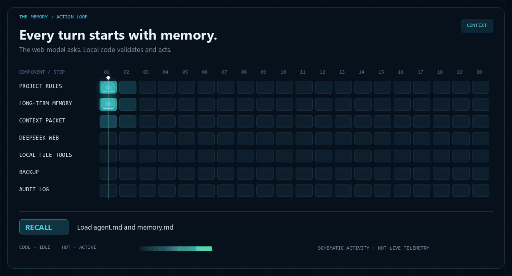

<p align="center">
  <a href="README.md">English</a> · <a href="README.zh-TW.md"><strong>繁體中文</strong></a>
</p>

<p align="center">
  
</p>

<h1 align="center">Local Memory Bridge</h1>

<p align="center"><strong>讓網頁 AI 帶著專案記憶，在指定範圍內操作本機檔案。</strong></p>

<p align="center">
  <a href="package.json"></a>
  <a href="docs/VERIFICATION.md"></a>
  <a href="docs/ACCEPTANCE.md"></a>
  <a href="LICENSE"></a>
</p>

<p align="center">
  <a href="#快速開始">快速開始</a> · <a href="#看懂運作流程">運作流程</a> · <a href="#四個工具一個專案範圍">檔案工具</a> · <a href="#真實帳號驗收">驗收證據</a> · <a href="#使用界線">使用界線</a>
</p>

Local Memory Bridge 把已登入的 DeepSeek 網頁會話接到本機工作區。每次呼叫模型前，重新讀取 `agent.md` 與 `memory.md`；模型提出檔案操作後，由本機程式驗證路徑與參數、執行允許的動作，並留下紀錄。

**實際用途：**讀取專案筆記、建立摘要、修改一行狀態；換了對話後，仍能讀取已保存的專案背景。

> [!IMPORTANT]
> 本專案使用非官方的 DeepSeek 私有網頁介面，屬於實驗性整合。服務可用性、帳號限制與官方條款仍適用。專案上下文及工具讀取的檔案內容會送到模型供應商，使用前請閱讀 [安全與資料處理](SECURITY.md)。

## 看懂運作流程



*這是「讀取 → 建立 → 修改」任務的流程示意。亮色代表示意中的元件活動，不是即時監控或效能數據。[查看靜態版](assets/flow-heatmap-static.png) · [動畫原始碼](scripts/render_heatmap.py)*

1. **載入記憶**：每次模型呼叫前，重新讀取專案規則與長期記憶。
2. **模型判斷**：送出上下文封包，接回文字 JSON 格式的工具請求。
3. **本機執行**：檢查路徑與參數，再讀取、新建或替換文字。
4. **保存結果**：修改前先備份，寫入操作紀錄，再把工具結果交回模型。

持續執行，直到模型回覆完成或達到步數上限。

## 快速開始

**環境需求：**Node.js 22 以上、Windows PowerShell，以及已安裝的 Chrome／Chromium。目前完成驗證的平台是 Windows。

### 1. 下載 repo，安裝網頁核心的 runtime

```powershell
git clone https://github.com/ayase0307/local-memory-bridge.git
cd local-memory-bridge
npm --prefix core install --no-save --omit=dev --ignore-scripts --package-lock=false playwright-core@1.61.1
```

記憶層與檔案工具使用 Node 內建模組。獨立網頁核心使用 `playwright-core`，直接啟動已安裝的瀏覽器，不另外下載 Chromium。

### 2. 啟動核心並登入

```powershell
.\scripts\Start-DeepSeekCore.ps1
```

請在專用 Chrome 視窗親自登入。認證完成後，核心監聽 `http://127.0.0.1:18787`；保留這個終端。登入資料只保存在 Git 忽略的 `runtime/upstream/`。

### 3. 交給它一個小型檔案任務

在 repo 根目錄開啟第二個 PowerShell 終端：

```powershell
$env:BRIDGE_UPSTREAM_KEY = (Get-Content .\runtime\upstream\.api-key |
  Where-Object { $_.Trim() -and -not $_.Trim().StartsWith('#') } |
  Select-Object -First 1).Trim()

node src/cli.js init --project .\my-project
Set-Content .\my-project\note.txt 'Status: pending' -Encoding utf8

node src/cli.js agent --project .\my-project `
  --base-url http://127.0.0.1:18787/v1 --model deepseek-v4-flash `
  --message '讀取 note.txt，建立摘要 summary.md，再把 note.txt 的 Status: pending 替換成 Status: complete。'
```

執行 `agent` 代表授權本次任務在指定 `--project` 內使用允許的檔案工具。修改既有檔案時，必須符合原 SHA-256 與唯一文字匹配；備份與操作紀錄放在 `.file-agent/`。

`deepseek-v4-flash` 是附帶核心提供的公開模型別名，不能單憑此名稱證明上游實際模型版本。

## 可以直接檢視的記憶

```text
my-project/
├── agent.md                 專案規則，每回合重新讀取
├── memory.md                已確認的事實與決策，每回合重新讀取
├── .memory-bridge/          完成對話與專案操作鎖
└── .file-agent/
    ├── actions.jsonl        工具成功與錯誤紀錄
    └── backups/             修改前完整原文
```

```powershell
node src/cli.js remember --project .\my-project --text '這個專案一律使用台灣繁體中文。'
```

記憶採明確寫入。模型回答不會自動變成長期事實，完整對話紀錄也不會預設全部重送。

## 四個工具，一個專案範圍

| 工具 | 能做的事 | 執行前的檢查 |
| --- | --- | --- |
| `list_files` | 列出最多 200 個直接子項 | 專案內相對目錄，隱藏受保護項目 |
| `read_file` | 讀取 UTF-8 原文與 SHA-256 | 64 KiB 上限，拒絕秘密路徑與連結 |
| `create_file` | 建立新文字檔 | 獨占建立，保留既有檔案 |
| `replace_text` | 替換唯一一次完全相符的文字 | 核對目前 hash，修改前備份 |

模型使用**文字 JSON 協定**提出請求；這是應用層工具，不是 DeepSeek 原生 function calling。沒有 shell 或刪檔工具。[完整契約 →](docs/FILE-AGENT.md)

## 真實帳號驗收

**2026-10-15** 在獨立測試專案完成以下驗收：

| 項目 | 觀察結果 |
| --- | --- |
| 兩回合記憶重讀 | 修改 memory.md 後答案逐字正確；9.384 秒、8.655 秒 |
| 讀取 → 建立 → 修改 | 4 次模型呼叫、25.893 秒；實際檔案位元組符合預期 |
| 備份與操作紀錄 | 1 份修改前備份、3 筆成功工具紀錄 |
| 本機測試 | 62 項通過，0 失敗、0 略過 |
| 修正版網頁核心 | 95 項測試、typecheck、lint、build 通過 |

耗時只描述當次小型驗收任務。[驗收報告](docs/ACCEPTANCE.md) · [驗證紀錄](docs/VERIFICATION.md) · [實檔證據](examples/verified-run/) · [獨立審查](docs/FILE-AGENT-REVIEW.md)

## 其他使用入口

| 命令 | 用途 |
| --- | --- |
| `pack`／`record` | 匯出記憶封包，匯入人工取得的回答 |
| `chat` | 經本機核心完成一個文字回合 |
| `serve` | 固定專案、非串流的 Chat Completions 子集 |
| `agent` | 多步檔案任務，預設最多 12 次模型呼叫 |

HTTP adapter 只接受一則純文字 `user` 訊息與 `stream:false`；沒有開放檔案代理迴圈，也不是完整 OpenAI／Responses 相容介面。[CLI 說明](src/cli.js) · [完整操作手冊](docs/USAGE.zh-TW.md) · [Codex 技能](skills/local-memory-bridge/SKILL.md)

## 使用界線

- **明確範圍**：只接受專案內相對路徑，拒絕路徑越界、symlink、junction、hardlink、憑證與內部紀錄。根目錄 agent.md／memory.md 透過明確的記憶操作維護。
- **小型文字任務**：UTF-8 單檔 64 KiB，上下文 32,000 字元，預設 12 次模型呼叫，可設 1–30 次；父目錄須已存在。
- **變更可檢視**：保留修改前備份與 audit；後續失敗不會撤銷先前成功的變更，重試前先檢查紀錄。
- **單一寫入者**：專案鎖只協調本工具。避免外部編輯器同時改同一批檔案；沒有作業系統 sandbox 或原子 compare-and-swap 保證。
- **結果未知就停下**：不自動重送逾時或結果不明的 completion。網頁免費使用不代表無限額度或永久免費 API。

私有介面與帳號使用限制，請參閱 [DeepSeek 官方條款](https://cdn.deepseek.com/policies/en-US/deepseek-terms-of-use.html) 與 [SECURITY.md](SECURITY.md)。

## 開發

```powershell
npm test
node scripts/check-docs.mjs
```

本機測試只使用臨時專案與模擬 loopback 上游，不需要 DeepSeek 帳號。CI 使用 Windows 與 Node 22／24。重建 GIF 時，安裝 Pillow 後執行 `python scripts/render_heatmap.py`。

[參與開發](CONTRIBUTING.md) · [架構與計畫](docs/PLAN.md) · [視覺資產來源](assets/README.md)

## 致謝與授權

網頁 adapter 基於 [kittors/deepseek-web-api](https://github.com/kittors/deepseek-web-api) 的 `9b62d6a` commit，加入本地導頁競態與 SSE 修正；原始碼與 MIT 歸屬保留在 core/。[第三方說明](THIRD_PARTY.md)

Local Memory Bridge 採 [MIT License](LICENSE)。程式碼授權與上游服務條款分別適用。
